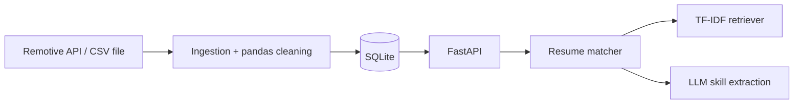

# jobscope


A job-market tracker and resume matcher. It ingests job listings, cleans messy data,
stores it in SQL, serves a typed REST API, and matches a resume to jobs using TF-IDF
retrieval plus LLM-extracted skills.

> **Data note:** the demo dataset is synthetic, generated by `scripts/make_sample_data.py`.
> The Remotive source is real, but its public feed is small, so it is used to exercise the
> API client, not for analysis. Match results on the demo data show how the system works,
> not real hiring trends.

**Live demo:** https://jobscope-vmcj.onrender.com/docs. It runs on a free tier that sleeps when idle, so the
first load can take a minute. Data resets on every restart, so uploaded resumes are not
kept. Read-only endpoints are public; resume and AI endpoints require an API key.

## Architecture



## What it does

- Ingests jobs from a REST API (retries with backoff) or a messy CSV, cleaning duplicates,
  mixed date formats, inconsistent locations, HTML descriptions and free-text salaries.
- Stores jobs and skills in SQLite with a many-to-many schema and analytics queries
  (top skills, company ranking with window functions, jobs per week).
- Extracts skills from text with an LLM, with output validated by Pydantic and retried on
  invalid results.
- Matches a resume to jobs: TF-IDF finds similar jobs, then a deterministic score blends
  text similarity with skill overlap and lists skill gaps.

## Run locally

```powershell
python -m venv .venv
.venv\Scripts\Activate.ps1
pip install -e ".[dev]"
python scripts\make_sample_data.py
copy .env.example .env    # then add your GROQ_API_KEY
uvicorn jobscope.api.main:app --reload
pytest
```

Open http://127.0.0.1:8000/docs. With `JOBSCOPE_API_KEY` unset, auth is disabled locally.

## API

| Method | Path | Auth | Purpose |
|---|---|---|---|
| GET | `/health` | no | liveness check |
| GET | `/jobs`, `/jobs/{id}` | no | paginated list, job detail |
| GET | `/skills/trending` | no | most requested skills |
| POST | `/ingest?source=csv\|remotive` | key | load jobs (idempotent) |
| POST | `/backfill` | key | extract skills for jobs that have none |
| POST | `/resumes` | key | store a resume |
| POST | `/resumes/{id}/match` | key | score and store matches |
| GET | `/resumes/{id}/matches` | key | read stored matches |

## Design decisions

- **Interfaces over concrete classes.** `JobSource`, `LLMClient` and `Retriever` are
  protocols, so sources, models and retrieval can be swapped, and tests use fakes.
- **Idempotent ingestion.** `UNIQUE (source, source_id)` makes repeated loads safe.
- **Explicit date parsing.** Ambiguous dates are never guessed; unknown formats become null.
- **The model only extracts skills.** Scoring is plain, tested Python, so results are
  deterministic and cheap to re-run.
- **Tests never touch the network.** Model and HTTP calls are faked, CI runs on Python 3.10
  and 3.12, and lint (ruff) and types (mypy) are enforced.
- **Secure by default in production.** Resume and AI endpoints need an API key, and the app
  refuses to start in production without one.

## Limitations

- TF-IDF has no semantic understanding, so "postgres" and "postgresql" are different words.
  Embeddings behind the existing `Retriever` interface are the natural upgrade.
- Skill names are not normalized across sources.
- SQLite suits a single-instance demo; a multi-instance deployment would need Postgres.
- The retrieval index is rebuilt per match request, which is fine at hundreds of jobs.

## Skills demonstrated

| Skill | Where to look |
|---|---|
| Maintainable code | typed models, protocols, service layer, `ruff` + `mypy` in CI |
| Data | `ingestion/cleaning.py` (pandas), `db/repository.py` (SQL) |
| APIs | `ingestion/remotive.py` (consuming), `api/` (building with FastAPI) |
| Testing | `tests/`, fakes for HTTP and the model, CI matrix |
| Building with AI | `ai/` (validated structured output, retrieval, matching) |
